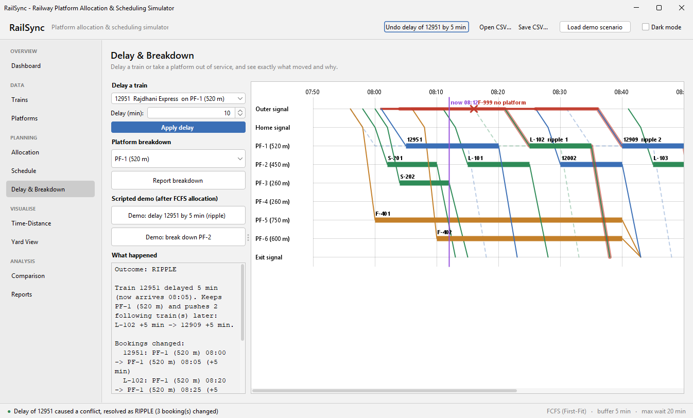

# RailSync: Railway Platform Allocation and Scheduling Simulator

RailSync is a Java desktop simulator that assigns arriving and departing trains to station platforms without
time conflicts, repairs the plan when trains are delayed or platforms break down, and keeps every session and
change in an embedded SQLite database.

**The idea behind it:** platforms behave like **CPUs**, trains like **processes**, a train's stay at the platform
like **burst time**, and the allocator like an **OS scheduler**. The four allocation policies mirror OS scheduling
algorithms (FCFS, Priority, Shortest-Job-First, Priority with Aging), and trains that wait at the outer signal form
a visible **ready queue**.

Because every train has fixed times, the real problem is closer to *interval scheduling* than to CPU scheduling,
and all four policies are greedy heuristics: none is globally optimal. RailSync is an educational simulation, not a
real signalling or safety system.

Built for an Object-Oriented Programming / Object-Oriented Modelling course and a Software Engineering course. The code is written to be studied:
every class has a header comment, every public method has Javadoc, every algorithm has numbered step comments, and
OOP concepts are tagged inline (`// [POLYMORPHISM]`, `// [COMPOSITION]`, `// [SOLID-D]` ...).



## Features

| Module | What you can do |
|---|---|
| A. Trains | Add, edit, search by number, remove (only if it has no platform), view its schedule. Express / Passenger / Freight behave differently (priority bonus, length, minimum stop, clearance). |
| B. Platforms | Add, edit (refused if it would break a booking), remove (only if empty), repair. Compatibility check lists every train with OK or the exact reason. |
| C. Allocation | Places trains with First-Fit, half-open intervals `[start, end)` and a configurable clearance buffer (default 5 min). Trains may wait at the outer signal up to a configurable maximum. Every refusal is explained. |
| D. Strategies | FCFS, Priority, Shortest Dwell First (SJF), Priority + Aging (configurable rate), and optional safe preemption. Switch strategy in the GUI. |
| E. Delays | Delay a train: kept, moved, **ripple** (following trains pushed, cascade reported) or a clear failure. Nothing changes silently. |
| E2. Breakdowns | Mark a platform failed: every train on it is moved if possible, and each one that can't move is reported with the reason. |
| F. Metrics | Waiting time, turnaround, averages, utilization per platform, conflicts, and the **sweep-line** minimum number of platforms. |
| F2. Comparison arena | The same trains through all four strategies on independent copies, side by side. Seeded random generator (10-500 trains). |
| Visualization | Time-distance / Gantt diagram, simulation clock (1x/10x/60x), 500 ms ghost-and-slide animation for delays and breakdowns, top-down yard view with a live ready queue. |
| Storage | Every change saved automatically to SQLite and restored at start-up; append-only **audit log** of every change (Reports screen). |
| Extras | CSV import/export, Undo (Ctrl+Z) for allocations and delays, light/dark theme switchable at any time, console demo. |

## Tech stack

Java 21 (runs on any JDK 21+), Swing, Maven (via the included Maven Wrapper), JUnit 5 and JaCoCo, FlatLaf (look and
feel and icons), SQLite through JDBC (`org.xerial:sqlite-jdbc`, embedded: nothing to install). No network,
frameworks or threads; animation uses Swing Timers.

## Project structure

```
pom.xml, mvnw, mvnw.cmd          build (Maven Wrapper: no Maven install needed)
run-app.cmd                      build and open the desktop app
run-tests.cmd                    build and run all JUnit tests
run-demo.cmd                     text-only demo of the model and services
src/main/java/com/railsync/
  Main.java                      starts the GUI (wires the objects together)
  ConsoleDemo.java               console showcase of stages 1-4
  exception/                     RailSyncException and 4 specific exceptions
  model/                         Train hierarchy, Platform, Station, Schedule, PlatformReservation,
                                 ReservationChange, TrainMovement, TrainFactory, enums
  strategy/                      PlatformAllocationStrategy + FCFS, Priority, SJF, Aging, catalog
  observer/                      ScheduleObserver, ScheduleEvent(Type), ScheduleEventManager
  service/                       SchedulingService (facade), PlatformAllocator, DelayManager,
                                 TrainManager, PlatformManager, MetricsCalculator, ReportGenerator,
                                 StrategyArena, ScenarioGenerator, ScenarioCsv, undo commands ...
  persistence/                   SQLite: Database (schema, migrations), DAOs, StationRepository,
                                 AuditLog, AutoSaver (saves after every change)
  ui/                            Swing screens, diagrams, dialogs, table models, theme, icons
src/main/resources/              SVG icons
src/test/java/com/railsync/      224 automated tests: unit, boundary, integration, system, performance
                                 (+ ScreenshotMaker developer tool)
docs/                            OOP documentation, UML, user guide, screenshots, sample CSV
docs/se/                         software engineering documents (SRS ... maintenance, contributions)
```

## Setup and run (Windows)

You need a JDK, version 21 or newer, on the `PATH`. Check with:

```bash
java -version
```

Then, in the project folder, either double-click `run-app.cmd`, or run:

```bash
mvnw.cmd -B package
```

```bash
java -jar target\railsync-1.1.0.jar
```

The first build downloads Maven and the libraries from Maven Central (one time only).

Your work is saved automatically in `%USERPROFILE%\.railsync\railsync.db` (on macOS/Linux `~/.railsync/railsync.db`)
and restored the next time you start RailSync. On the first start the demo scenario is loaded. To use another
database file, start with `java -Drailsync.db=path\to\file.db -jar target\railsync-1.1.0.jar`.

Other commands:

```bash
mvnw.cmd test
```

(runs all 224 tests and writes a coverage report to `target\site\jacoco\index.html`; the 10 system tests open
the real window briefly)

```bash
java -cp target\classes com.railsync.ConsoleDemo
```

To browse all the documentation (README, guides, rendered UML diagrams, screenshots) as a small website,
double-click `preview-docs.cmd`. It serves the project on http://localhost:8080/docs/ with the JDK's built-in
`jwebserver` (Java 18+) and opens your browser; press Ctrl+C in its window to stop.

## Using it

On the first start the demo scenario is loaded but not allocated (later starts restore your last session; press
*Load demo scenario* to start the tour from the beginning). A five-minute tour:

1. **Allocation**: keep FCFS and press *Allocate all pending trains*. 11 of 12 trains are placed and F-999 is refused (it fits no platform).
2. Press *Reset all allocations*, choose **Priority**, and allocate again. Now 12002 gets PF-2 at 08:15 and L-102 loses out.
3. **Time-Distance**: see every train's path; red = waiting in the queue. Press *Play*.
4. Reset, allocate with FCFS, then **Delay & Breakdown**: *Demo: delay 12951 by 5 min* shows a ripple of 2 trains, with ghosts. Press **Undo** (Ctrl+Z) to take it back.
5. *Demo: break down PF-2*: S-201 moves to PF-4, and the others are reported as stranded.
6. **Yard View**: press Play and watch the ready queue; *Switch strategy from now* re-plans the future.
7. **Comparison**: run all strategies on the demo or on a generated scenario of up to 500 trains.
8. **Reports → Audit log (database)**: every change you just made, with its time. Close and reopen the app: the
   plan is still there.

See [docs/USER_GUIDE.md](docs/USER_GUIDE.md) for every screen.

## Documentation

| File | Contents |
|---|---|
| [docs/OOP_CONCEPTS.md](docs/OOP_CONCEPTS.md) | Every OOP concept and SOLID principle, with the exact classes, methods and line tags |
| [docs/DESIGN_PATTERNS.md](docs/DESIGN_PATTERNS.md) | Strategy, Observer, Factory, Command, with code excerpts |
| [docs/UML_DIAGRAMS.md](docs/UML_DIAGRAMS.md) | 14 diagrams: use-case, class, sequence, activity, state, component, package, deployment, ER (Mermaid) |
| [docs/CLASS_EXPLANATION.md](docs/CLASS_EXPLANATION.md) | Every class: purpose, attributes, methods, relationships |
| [docs/USER_GUIDE.md](docs/USER_GUIDE.md) | How to use each screen |
| [docs/VIVA_GUIDE.md](docs/VIVA_GUIDE.md) | Study order, likely questions with answers, trade-offs, limitations |
| [docs/PROGRESS.md](docs/PROGRESS.md) | Stage-by-stage build log with every design decision |
| [CHANGELOG.md](CHANGELOG.md) | What changed in each version |

### Software engineering documents

| File | Contents |
|---|---|
| [docs/se/SRS.md](docs/se/SRS.md) | Software Requirements Specification: users, constraints, 45 functional and 20 non-functional requirements |
| [docs/se/REQUIREMENTS_ANALYSIS.md](docs/se/REQUIREMENTS_ANALYSIS.md) | Stakeholders, actors, use-case specifications, prioritisation, traceability matrix |
| [docs/se/ARCHITECTURE.md](docs/se/ARCHITECTURE.md) | Architecture, modules and responsibilities, design decisions, data and interface design |
| [docs/se/TEST_PLAN.md](docs/se/TEST_PLAN.md) | Test strategy, techniques (equivalence classes, boundary values), all test cases, test report |
| [docs/se/QUALITY_ASSURANCE.md](docs/se/QUALITY_ASSURANCE.md) | Reliability, maintainability, security, usability, performance: measures and evidence |
| [docs/se/PROJECT_PLAN.md](docs/se/PROJECT_PLAN.md) | Process model, WBS, milestones, Gantt chart, roles, RACI, effort estimation, risks |
| [docs/se/MAINTENANCE.md](docs/se/MAINTENANCE.md) | Kinds of maintenance, how to extend the system, database upgrades, releases, defect handling |
| [docs/se/CONTRIBUTIONS.md](docs/se/CONTRIBUTIONS.md) | What each team member did |

