# RailSync UML Diagrams

All diagrams are written in **Mermaid**. They render automatically on GitHub, in VS Code (with a Mermaid
extension) and at https://mermaid.live (paste the code). Every class, method and relationship shown exists in the
final code; nothing is fictional. To keep the diagrams readable, getters and small helpers are left out.

---

## 1. Use-case diagram

Mermaid has no dedicated use-case syntax, so actors are drawn as nodes and use cases as rounded boxes.

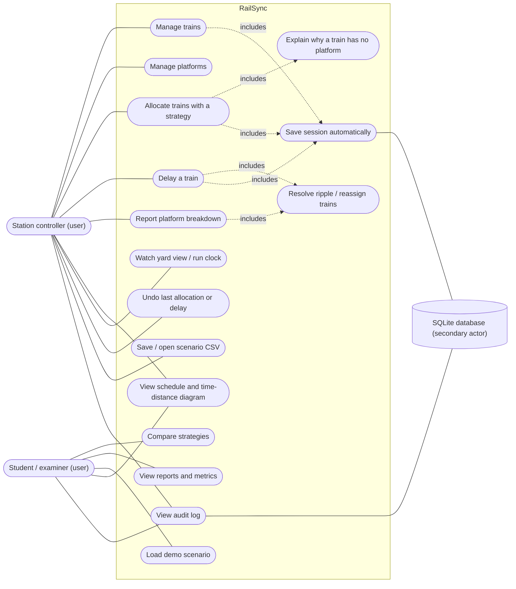

**In words:** the controller manages trains and platforms, allocates, delays trains and reports breakdowns.
Allocation always *includes* explaining refusals; delays and breakdowns *include* the shared reassignment logic.
The examiner (or student) mainly loads the demo, compares strategies and reads the reports and diagrams.
Every change *includes* saving the session automatically; the SQLite database is a secondary actor that stores
the session and the audit log.

---

## 2. Class diagram

```mermaid
classDiagram
    direction TB

    class Train {
        <<abstract>>
        -String id
        -String number
        -String name
        -LocalDateTime scheduledArrival
        -LocalDateTime scheduledDeparture
        -int basePriority
        -int carriageCount
        -int delayMinutes
        -TrainStatus status
        -Platform assignedPlatform
        +getType()* TrainType
        +getPriority()* int
        +getRequiredPlatformLength()* int
        +getMinimumDwellMinutes()* int
        +getClearanceBufferMinutes(int base) int
        +getIncompatibilityReason(Platform) String
        +canUsePlatform(Platform) boolean
        +updateTimes(LocalDateTime, LocalDateTime)
        +applyDelay(int)
        +reduceDelay(int)
        +getExpectedArrival() LocalDateTime
        +getDwellTime() Duration
        ~assignPlatform(Platform)
        ~clearPlatform()
    }
    class ExpressTrain {
        +getPriority() int
        +getRequiredPlatformLength() int
        +getMinimumDwellMinutes() int
    }
    class PassengerTrain {
        +getPriority() int
        +getRequiredPlatformLength() int
        +getMinimumDwellMinutes() int
    }
    class FreightTrain {
        +getPriority() int
        +getRequiredPlatformLength() int
        +getMinimumDwellMinutes() int
        +getClearanceBufferMinutes(int base) int
    }
    Train <|-- ExpressTrain
    Train <|-- PassengerTrain
    Train <|-- FreightTrain

    class Platform {
        -String id
        -int number
        -int lengthMeters
        -PlatformStatus status
        -Set~TrainType~ supportedTypes
        +supports(TrainType) boolean
        +isOperational() boolean
        +markFailed()
        +markOperational()
    }
    class Station {
        -String name
        -List~Platform~ platforms
        +addPlatform(Platform)
        +removePlatform(Platform) boolean
        +findPlatformById(String) Platform
    }
    class Schedule {
        -List~PlatformReservation~ reservations
        -Map~String,PlatformReservation~ reservationByTrainId
        -int clearanceBufferMinutes
        +reserve(Train, Platform, LocalDateTime) PlatformReservation
        +release(Train) boolean
        +findConflict(Train, Platform, LocalDateTime) PlatformReservation
        +findAllConflicts(Train, Platform, LocalDateTime) List
        +earliestFreeStart(Train, Platform, LocalDateTime) LocalDateTime
        +requiredGapMinutes(Train, Train) int
        +overlaps(...)$ boolean
    }
    class PlatformReservation {
        -Train train
        -Platform platform
        -LocalDateTime start
        -LocalDateTime end
    }
    Station "1" o-- "0..*" Platform : aggregation
    Schedule "1" *-- "0..*" PlatformReservation : composition
    PlatformReservation "0..*" --> "1" Train
    PlatformReservation "0..*" --> "1" Platform
    Train "0..*" --> "0..1" Platform : assignedPlatform (association)

    class PlatformAllocationStrategy {
        <<interface>>
        +getName() String
        +getDescription() String
        +orderReadyQueue(List~Train~, LocalDateTime) List~Train~
    }
    class QueueOrderingStrategy {
        <<abstract>>
        +orderReadyQueue(List~Train~, LocalDateTime) List~Train~
        #compareByPolicy(Train, Train, LocalDateTime)* int
    }
    class FcfsStrategy
    class PriorityStrategy
    class ShortestDwellFirstStrategy
    class PriorityAgingStrategy {
        -int minutesPerPriorityPoint
        +getEffectivePriority(Train, LocalDateTime) int
    }
    PlatformAllocationStrategy <|.. QueueOrderingStrategy
    QueueOrderingStrategy <|-- FcfsStrategy
    QueueOrderingStrategy <|-- PriorityStrategy
    QueueOrderingStrategy <|-- ShortestDwellFirstStrategy
    QueueOrderingStrategy <|-- PriorityAgingStrategy

    class SchedulingService {
        -PlatformAllocationStrategy strategy
        -CommandHistory history
        -int conflictsDetected
        +setStrategy(PlatformAllocationStrategy)
        +allocatePendingTrains() List~AllocationResult~
        +delayTrain(Train, int) DelayReport
        +reportBreakdown(Platform) BreakdownReport
        +reallocateFrom(LocalDateTime) List~AllocationResult~
        +undoLast() String
        +calculateMetrics() ScheduleMetrics
    }
    class PlatformAllocator {
        -int maxWaitMinutes
        -boolean preemptionEnabled
        +allocateAll(List~Train~, PlatformAllocationStrategy) List~AllocationResult~
        +allocateSingle(Train) AllocationResult
        +findFirstFreePlatform(Train, LocalDateTime) Platform
    }
    class DelayManager {
        +delayTrain(Train, int) DelayReport
        +handleBreakdown(Platform) BreakdownReport
    }
    class TrainManager {
        -List~Train~ trains
        -Map~String,Train~ trainsByNumber
        +addTrain(Train)
        +removeTrain(Train)
        +findByNumber(String) Train
    }
    class PlatformManager {
        +addPlatform(Platform)
        +removePlatform(Platform)
        +updatePlatform(Platform, int, Set)
    }
    class MetricsCalculator {
        +calculate(Station, Schedule, List~Train~, int) ScheduleMetrics
        +minimumPlatformsNeeded(List~Train~, int) int
    }
    SchedulingService *-- TrainManager
    SchedulingService *-- PlatformManager
    SchedulingService *-- PlatformAllocator
    SchedulingService *-- DelayManager
    SchedulingService *-- MetricsCalculator
    SchedulingService o-- Station
    SchedulingService o-- Schedule
    SchedulingService --> PlatformAllocationStrategy : injected
    PlatformAllocator ..> PlatformAllocationStrategy : uses
    PlatformAllocator --> Schedule
    PlatformAllocator --> Station
    DelayManager --> PlatformAllocator
    DelayManager --> Schedule

    class ScheduleObserver {
        <<interface>>
        +onScheduleEvent(ScheduleEvent)
    }
    class ScheduleEventManager {
        -List~ScheduleObserver~ observers
        +subscribe(ScheduleObserver)
        +publish(ScheduleEvent)
    }
    class RefreshablePanel {
        <<abstract>>
        +refresh()*
    }
    SchedulingService --> ScheduleEventManager : publishes
    ScheduleEventManager "1" o-- "0..*" ScheduleObserver
    ScheduleObserver <|.. RefreshablePanel
    ScheduleObserver <|.. TimeDistanceDiagram
    ScheduleObserver <|.. StatusBar
    RefreshablePanel <|-- AllocationPanel
    RefreshablePanel <|-- TrainPanel

    class ScheduleCommand {
        <<interface>>
        +execute()
        +undo()
        +getDescription() String
    }
    class SnapshotCommand {
        <<abstract>>
        +undo()
        #reverseOwnChange()
    }
    ScheduleCommand <|.. SnapshotCommand
    SnapshotCommand <|-- AllocateCommand
    SnapshotCommand <|-- DelayCommand
    SchedulingService *-- CommandHistory
    CommandHistory "1" o-- "0..20" ScheduleCommand

    class TrainFactory {
        +create(TrainType, ...)$ Train
    }
    TrainFactory ..> Train : creates
```

**How to read it**

- **Inheritance** (solid line, hollow triangle): the three Train kinds extend the abstract `Train`; the four
  strategies extend `QueueOrderingStrategy`; the two commands extend `SnapshotCommand`; the screens extend `RefreshablePanel`.
- **Interface realization** (dashed line, hollow triangle): `QueueOrderingStrategy` implements
  `PlatformAllocationStrategy`; `SnapshotCommand` implements `ScheduleCommand`; screens implement `ScheduleObserver`.
- **Composition** (filled diamond): `Schedule` owns 0..* `PlatformReservation`s (it creates and deletes them);
  `SchedulingService` creates and owns its managers, allocator, delay manager, calculator and history.
- **Aggregation** (hollow diamond): `Station` holds 0..* `Platform`s that exist on their own; the service is given
  the station and schedule; the event manager holds observers it did not create.
- **Association** (arrow): each `Train` refers to 0..1 assigned `Platform`; each reservation refers to one train and one platform.
- **Dependency** (dashed arrow): the allocator *uses* a strategy passed in per call; the factory *creates* trains.
- `*` after a method = abstract; `$` = static; `~` = package-private; `#` = protected.

---

## 3. Sequence diagram: allocation

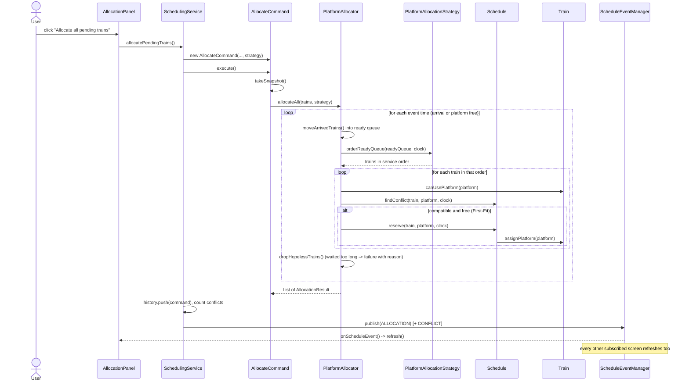

**In words:** the panel only calls the service. The service wraps the work in an undoable command. The allocator
runs its event loop: at each moment the strategy orders the ready queue, and each train takes the first free
compatible platform. Schedule is the only class that creates the booking and links the train. Finally the service
publishes events and every screen refreshes itself.

---

## 4. Sequence diagram: delay and reassignment (ripple)

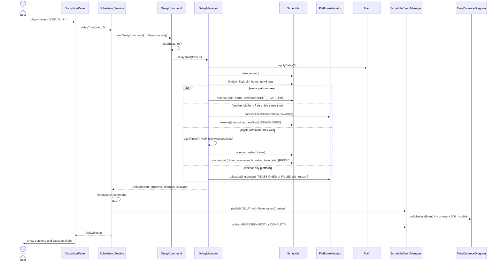

**In words:** the delay is recorded first (invalid minutes stop everything before any change). The old slot is freed
and the least disruptive option is tried first. Every move becomes a `ReservationChange`, which the report lists and
the diagram animates. A breakdown (`DelayManager.handleBreakdown`) reuses the same two reassignment steps:
same time on another platform, otherwise `allocateSingle` with waiting.

---

## 5. Activity diagram: allocation of a train

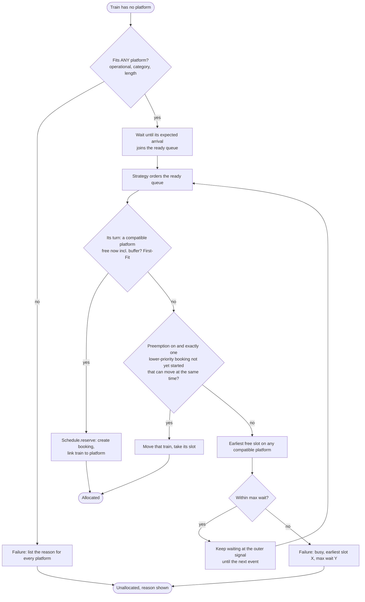

**In words:** compatibility is checked first. Then the train queues and the strategy decides who goes next; the
train takes the lowest-numbered free compatible platform (the half-open interval plus buffer must be free). If
nothing is free it may preempt (only safely), or it waits, and once the earliest possible slot is beyond the
maximum wait it is refused with the reason.

---

## 6. State diagram: train status (`TrainStatus`)

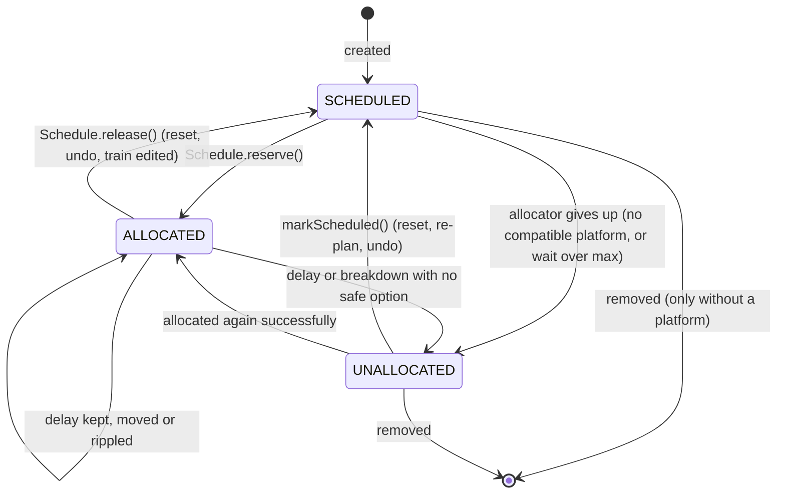

**In words:** a new train is SCHEDULED. Only `Schedule.reserve()` can make it ALLOCATED (the link method is
package-private), and only `release()` takes that away, so the status and the booking can never disagree. A
train the allocator or the delay manager cannot place safely becomes UNALLOCATED, always with a reason, and
returns to SCHEDULED when the plan is reset. A train holding a platform cannot be removed.

## 7. State diagram: a train moving through the station (`TrainMovement.Phase`)

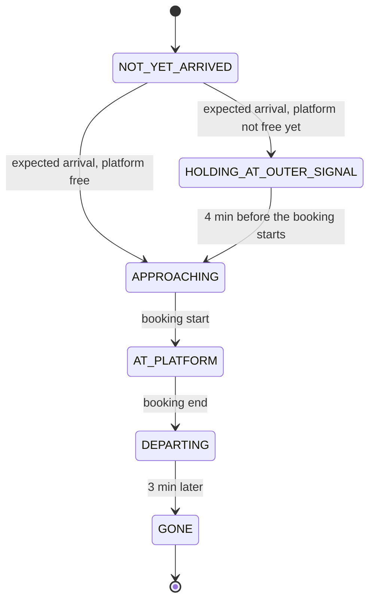

**In words:** this is the behaviour the time-distance diagram and the yard view draw at the simulated time.
Each phase is a half-open interval, so at any minute a train is in exactly one phase. Holding at the outer
signal is the visible ready queue.

## 8. State diagram: platform (`PlatformStatus`)

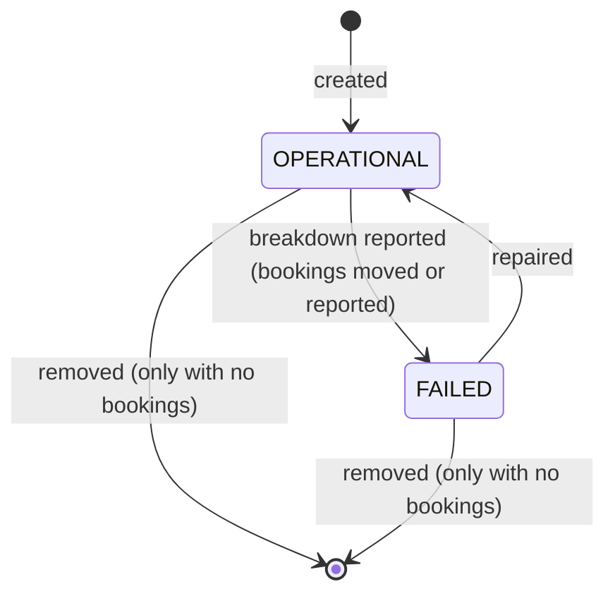

---

## 9. Component diagram

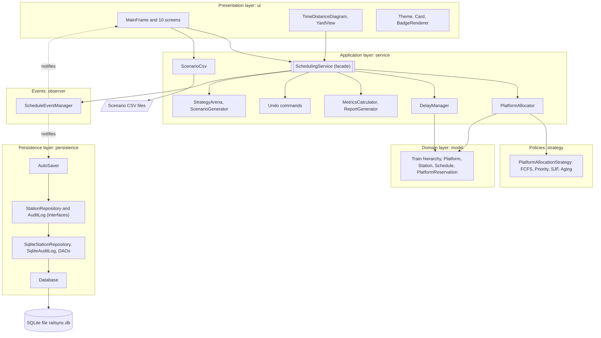

**In words:** the screens only talk to the `SchedulingService` facade. The services use the strategy interface
and the domain model. Every change is published as an event; the screens and the `AutoSaver` both listen. The
auto-saver writes through the two repository interfaces, so only the `persistence` package knows about SQLite.

## 10. Package diagram (dependencies point downward only)

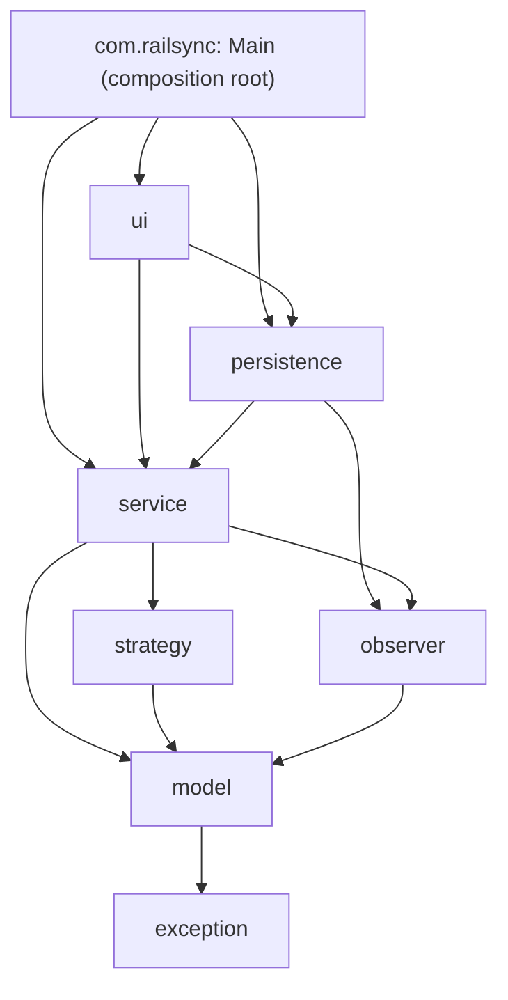

`ui` depends on `persistence` only for the `AuditLog` interface (Reports screen) and the `AutoSaver` save
indicator. No package below `ui` imports Swing, and nothing outside `persistence` imports `java.sql`.

## 11. Deployment diagram

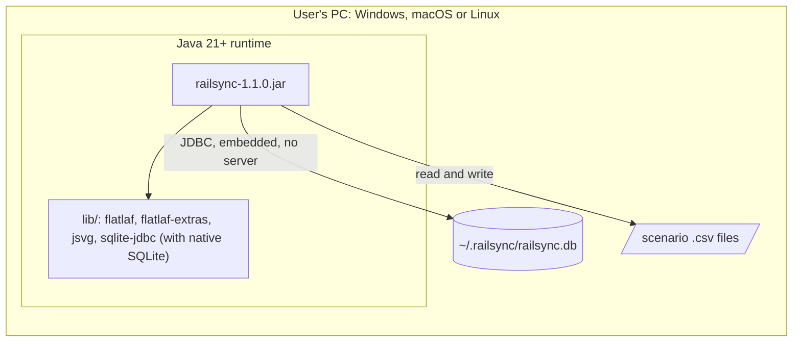

**In words:** RailSync is a single desktop process. There is no server and no network: SQLite runs inside the
same process through the JDBC driver and stores everything in one file in the user's home folder (the location
can be changed with `-Drailsync.db=path`).

## 12. Entity-relationship diagram (database schema, version 1)

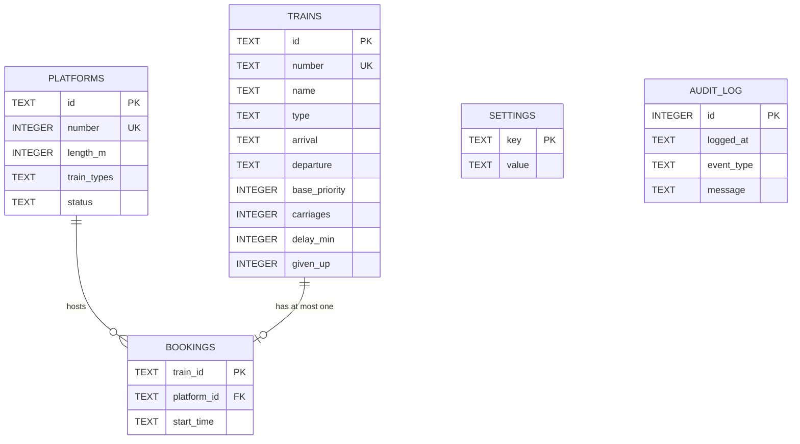

**In words:** a booking belongs to exactly one train (the train id is its primary key and a foreign key with
`ON DELETE CASCADE`, so the database itself refuses a second booking for a train) and one platform. CHECK
constraints guard the values (number and length above 0, priority 1 to 5, delay at least 0, status and type from
a fixed list). `SETTINGS` is a key/value table, so new settings need no schema change. `AUDIT_LOG` is
append-only. The schema version is kept in `PRAGMA user_version`.

## 13. Class diagram: persistence layer

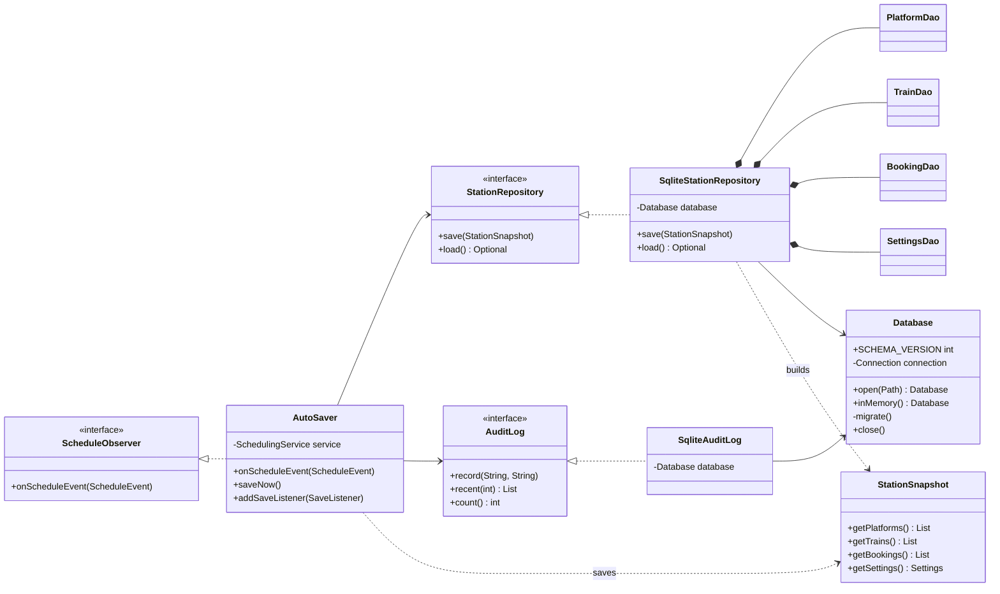

## 14. Sequence diagram: a change is saved automatically

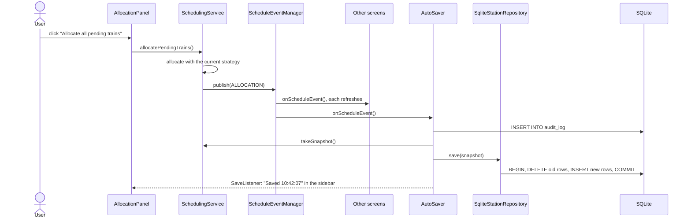

**In words:** the service does not know that it is being saved. It publishes the same event it always did; the
auto-saver, as one more observer, writes the audit entry and the whole session in one transaction. If the
database fails, the change still succeeds in memory and the sidebar shows "Save failed".
