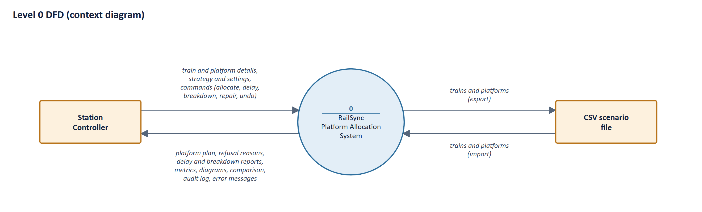
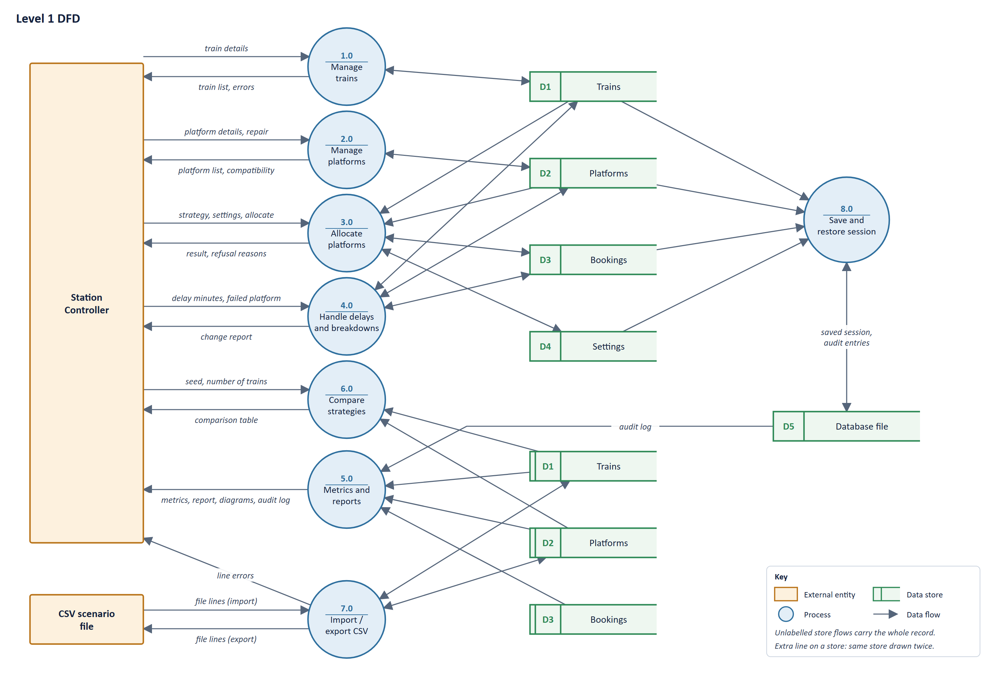
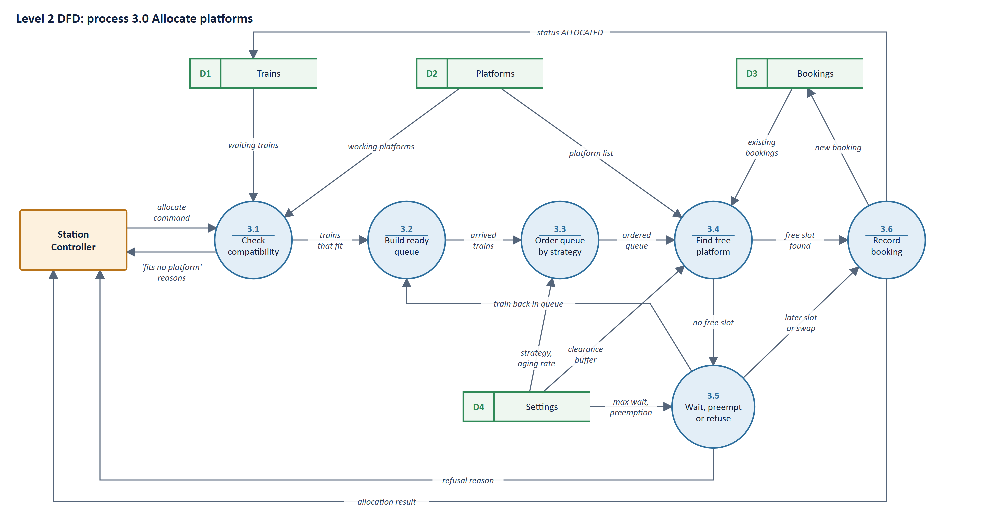
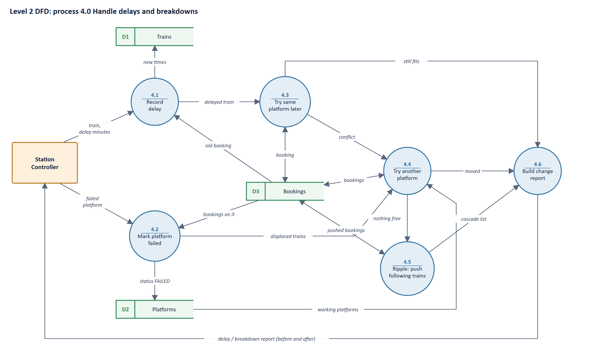
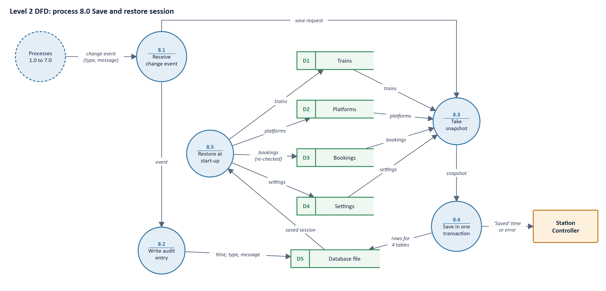

# Data Flow Diagrams (DFD)

The data flow diagrams show **where data comes from, what is done to it, where it is kept, and where it goes**.
They do not show the order of steps or the classes. That is done by the UML sequence, activity and class
diagrams in [UML_DIAGRAMS.md](../UML_DIAGRAMS.md).

The diagrams are drawn at three levels:

| Level | Shows | Diagram |
|---|---|---|
| 0 (context diagram) | The whole system as one process and the outside world it talks to | DFD 1 |
| 1 | The eight main processes inside RailSync and the data stores they share | DFD 2 |
| 2 | The steps inside the three most important processes: allocation, delays and breakdowns, and saving | DFD 3 to DFD 5 |

---

## Notation

| Symbol | Meaning | Example |
|---|---|---|
| Rectangle | **External entity**: a person or thing outside the system that sends or receives data | Station Controller |
| Circle (numbered) | **Process**: something that changes or moves data | 3.0 Allocate platforms |
| Open-ended box with an ID (D1 to D5) | **Data store**: data that is kept and used again later | D1 Trains |
| Labelled arrow | **Data flow**: data moving in the direction of the arrow | train details |

Rules followed in every diagram:
- Every process has at least one input and one output.
- Data never moves directly between two entities or two stores. It always goes through a process.
- Each process number is kept at the next level. Process 3.0 is split into 3.1, 3.2, and so on.
- A Level 2 diagram has the same inputs and outputs as its process in Level 1. This is called balancing.
- A flow into or out of a data store is not labelled when it carries the whole record (for example, a train).
- To avoid crossing lines, a store may be drawn twice. The copy has an extra line on its left edge.

---

## Data stores

| Store | Contents | Where it is kept |
|---|---|---|
| D1 Trains | Number, name, type, times, priority, coaches, delay, status | In memory while the program runs (`Station`) |
| D2 Platforms | Number, length, accepted train types, working or failed | In memory (`Station`) |
| D3 Bookings | Which train is on which platform and from when to when | In memory (`Schedule`) |
| D4 Settings | Strategy, clearance buffer, maximum wait, aging rate, preemption on or off | In memory (`SchedulingService`) |
| D5 Database file | Saved copy of D1 to D4, plus the audit log of every change | On disk: the SQLite file `railsync.db` |

D1 to D4 are the working data. D5 is the permanent copy on disk. Process 8.0 copies D1 to D4 into D5 after every
change and copies them back when the program starts.

---

## Level 0: Context diagram

RailSync has two external entities:
- **The Station Controller**: the person using the program (in the course setting, a student or an examiner).
- **A CSV scenario file**: a timetable file that is read in or written out.

*DFD 1. Level 0 DFD (context diagram).*

| Flow | From | To | Data |
|---|---|---|---|
| Input | Station Controller | RailSync | Train details, platform details, strategy and settings, commands (allocate, delay, breakdown, repair, undo, reset, load demo) |
| Output | RailSync | Station Controller | Platform plan, refusal reasons, delay and breakdown reports, metrics, time-distance diagram, yard view, strategy comparison, audit log, error messages |
| Input | CSV file | RailSync | Trains and platforms to import |
| Output | RailSync | CSV file | Trains and platforms exported |

---

## Level 1: Main processes

*DFD 2. Level 1 DFD.*

| Process | What it does | Inputs | Outputs | Requirements |
|---|---|---|---|---|
| 1.0 Manage trains | Adds, edits, finds and removes trains, after checking the values | Train details | D1, train list, error messages | FR-TM-01 to 07 |
| 2.0 Manage platforms | Adds, edits, removes and repairs platforms; lists which trains can use a platform | Platform details | D2, platform list, compatibility list | FR-PM-01 to 05 |
| 3.0 Allocate platforms | Gives each waiting train a platform using the chosen strategy, without overlaps | Allocate command, D1, D2, D4 | D3, result, refusal reasons | FR-AL, FR-ST |
| 4.0 Handle delays and breakdowns | Applies a delay or a breakdown and repairs the plan, reporting every change | Delay minutes, failed platform, D1 to D3 | D1 to D3, delay or breakdown report | FR-DL-01 to 05 |
| 5.0 Produce metrics and reports | Calculates waiting time, utilization and minimum platforms; draws the diagrams; shows the audit log | D1, D2, D3, D5 | Metrics, report, diagrams, audit log | FR-MR, FR-VI, FR-DS-03 |
| 6.0 Compare strategies | Runs all four strategies on copies of the data and compares them | Seed, size, D1, D2 | Comparison table | FR-CA-01, 02 |
| 7.0 Import / export scenario | Reads a CSV file after checking every line, or writes one | File lines, D1, D2 | D1, D2, file lines, line errors | FR-DS-04 |
| 8.0 Save and restore session | Saves D1 to D4 into the database after every change and loads them at start-up | D1 to D4, D5 | D5, restored D1 to D4 | FR-DS-01 to 03 |

Process 6.0 only **reads** D1 and D2. It works on copies, so the real plan never changes (FR-CA-01).

---

## Level 2: Inside process 3.0 (Allocate platforms)

*DFD 3. Level 2 DFD for process 3.0.*

| Process | What it does |
|---|---|
| 3.1 Check compatibility | Removes trains that fit no working platform (wrong type or too long) and reports why for each platform. |
| 3.2 Build ready queue | Moves the clock forward. A train that has arrived joins the queue (like a process joining the CPU ready queue). |
| 3.3 Order queue by strategy | Sorts the queue with FCFS, Priority, Shortest Dwell First or Priority with Aging. Ties go to the earlier arrival. |
| 3.4 Find free platform | Tries the lowest-numbered compatible platform whose time `[start, end)` plus the clearance gap overlaps no booking. |
| 3.5 Wait, preempt or refuse | With no free platform, the train waits at the outer signal. It may take a lower-priority booking if preemption is on and the other train can move without waiting. After the maximum wait it is refused with a reason. |
| 3.6 Record booking | Writes the booking (the only place a booking is created) and marks the train allocated. |

---

## Level 2: Inside process 4.0 (Handle delays and breakdowns)

*DFD 4. Level 2 DFD for process 4.0.*

| Process | What it does |
|---|---|
| 4.1 Record delay | Checks the minutes and adds them to the train's times. Remembers the old booking. |
| 4.2 Mark platform failed | Marks the platform failed, so no strategy can choose it. Takes the list of its bookings, earliest first. |
| 4.3 Try same platform later | Keeps the platform if the train still fits at the new time. This is the least disruptive option. |
| 4.4 Try another platform | Moves the train to another platform at the new time without disturbing anyone. For a breakdown this is where each displaced train goes. |
| 4.5 Ripple | Keeps the platform and pushes the trains behind it later, one by one, until there is enough room. If the train still cannot be placed it is left unallocated with a reason. |
| 4.6 Build change report | Lists every booking before and after. The screens use this list to show and animate the changes, so nothing changes silently. |

---

## Level 2: Inside process 8.0 (Save and restore session)

*DFD 5. Level 2 DFD for process 8.0.*

| Process | What it does |
|---|---|
| 8.1 Receive change event | Every change (allocation, delay, edit, import ...) publishes an event. The saver listens like any screen does (Observer pattern). |
| 8.2 Write audit entry | Adds one line (time, type, message) to the audit log. Lines are only added, never changed. |
| 8.3 Take snapshot | Copies trains, platforms, bookings and settings into one snapshot object. |
| 8.4 Save in one transaction | Replaces the saved tables in one transaction: either everything is saved or nothing is. The sidebar shows the time saved, or the error. |
| 8.5 Restore at start-up | Reads the snapshot back and places every booking again through the normal booking rules. If the data is damaged, the demo scenario is loaded instead. |

---

## How the DFDs relate to the rest of the design

| DFD element | Where it is in the design |
|---|---|
| Process 1.0, 2.0 | `TrainManager`, `PlatformManager` |
| Process 3.0 | `PlatformAllocator` with a `PlatformAllocationStrategy` |
| Process 4.0 | `DelayManager` |
| Process 5.0 | `MetricsCalculator`, `ReportGenerator`, `TimeDistanceDiagram`, `YardView` |
| Process 6.0 | `StrategyArena`, `ScenarioGenerator` |
| Process 7.0 | `ScenarioCsv` |
| Process 8.0 | `AutoSaver`, `SqliteStationRepository`, `SqliteAuditLog` |
| D1, D2 | `Station` |
| D3 | `Schedule` and `PlatformReservation` |
| D5 | SQLite tables `trains`, `platforms`, `bookings`, `settings`, `audit_log` (see the ER diagram) |
